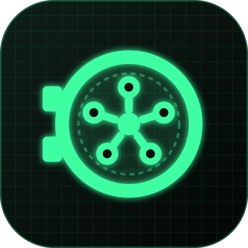
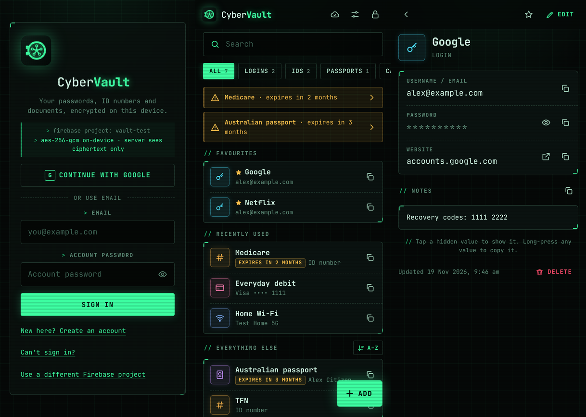
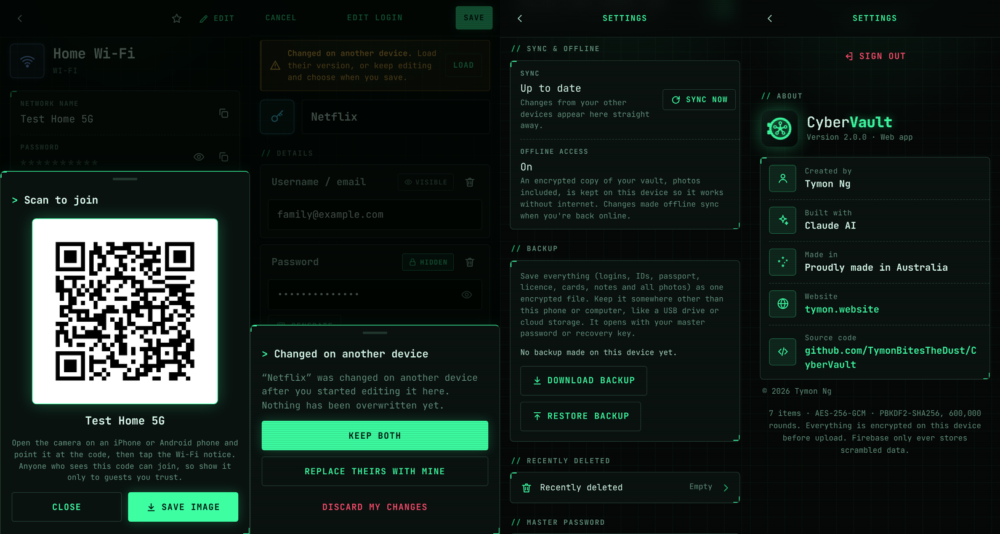
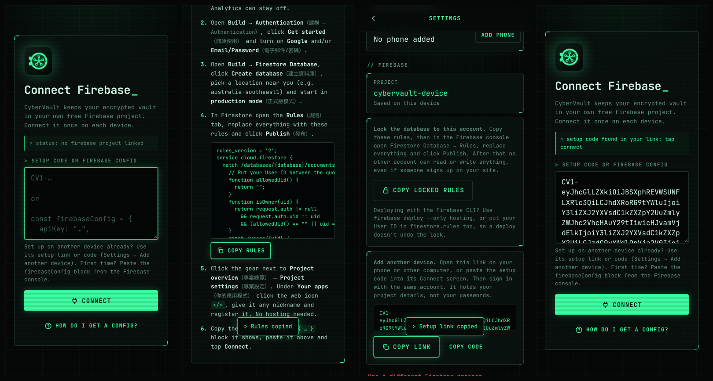
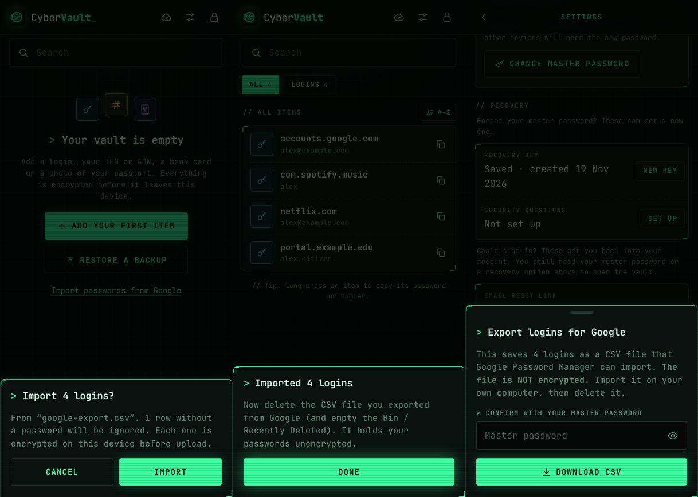
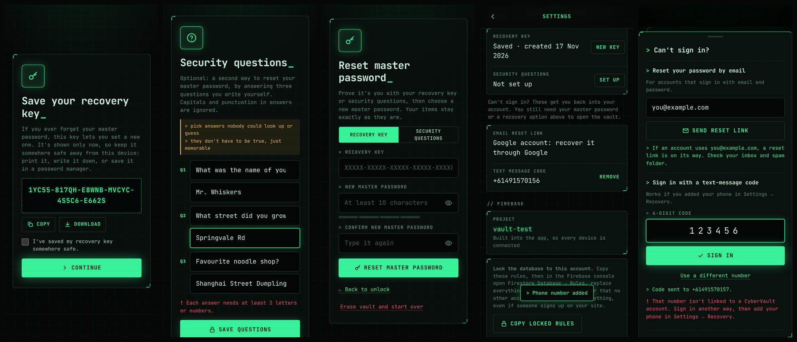
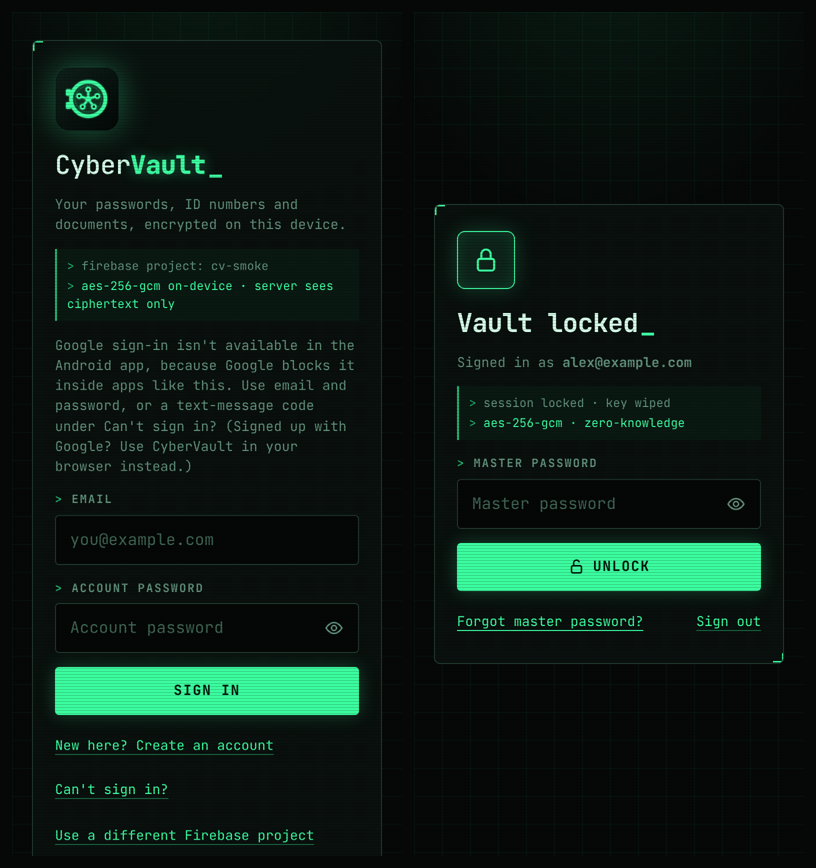

<p align="center"></p>
<h1 align="center">CyberVault</h1>
<p align="center"><b>Your personal encrypted vault</b> for logins, ID numbers, cards and document photos.<br>
Encrypted on your device, synced through your own Firebase project, and usable offline.</p>
<p align="center"><b>Version 2.0.0</b> · Made in Australia by Tymon Ng · Built with Claude AI · <a href="LICENSE">MIT licence</a></p>

<p align="center">
  <a href="https://github.com/TymonBitesTheDust/CyberVault/releases/latest/download/CyberVault.apk"><b>⬇ Android app (APK)</b></a> &nbsp;·&nbsp;
  <a href="https://github.com/TymonBitesTheDust/CyberVault/releases/latest/download/cybervault.html"><b>⬇ Web app (one HTML file)</b></a> &nbsp;·&nbsp;
  <a href="https://github.com/TymonBitesTheDust/CyberVault/releases/latest">All downloads</a>
</p>

<p align="center"></p>

## What's new in 2.0

<p align="center"></p>

- **Works offline.** An encrypted copy stays on each device. Changes you make offline sync by themselves when you're back online.
- **Live sync, with no silent overwrites.** Changes appear on your other devices straight away. If the same item is changed on two devices, CyberVault asks what to do, or keeps both.
- **Full encrypted backup.** One file with every item and photo. Restore it into any vault.
- **Recently deleted.** Deleted items can be restored for 30 days. Logins and Wi-Fi keep a **password history**.
- **New item types:** bank card, bank account (BSB and account number), and **Wi-Fi with a QR code** guests can scan to join.
- **Better dates.** Medicare and card dates (`MM/YYYY`, `MM/YY`) now get expiry warnings, and dates are checked as you type.
- **Favourites, recently used and sort options** for the list.
- **About** section at the bottom of Settings.

## Download

| You have… | Get |
|---|---|
| **An Android phone** | [**CyberVault.apk**](https://github.com/TymonBitesTheDust/CyberVault/releases/latest/download/CyberVault.apk): open the link on your phone and install it ([how](#android-app)) |
| **An iPhone, or any computer** | The web app. Put it online once (free, [setup](#setup-about-15-minutes-free)), then **Add to Home Screen** |

Every option needs **your own free Firebase project**: that's where your encrypted vault lives, so nobody else
(including me) holds your data. The [setup](#setup-about-15-minutes-free) takes about 15 minutes, and the app walks you through it.

All files are on the [Releases page](https://github.com/TymonBitesTheDust/CyberVault/releases/latest), with a `SHA256SUMS.txt` to check your download.

## Features

- **Zero-knowledge encryption.** Everything is encrypted in your browser with AES-256-GCM before upload. Firebase only ever stores scrambled data.
- **Master password every time** you open it. It locks itself when you're idle or leave the app.
- **Everything in one place:** logins, ID numbers (TFN, ABN, USI, Medicare, Centrelink…), passport, driver licence, bank cards, bank accounts, Wi-Fi and secure notes, with encrypted photos.
- **Copy in one tap:** a copy button on every value, or long-press it. The clipboard is cleared again after 30 seconds.
- **Expiry warnings** for passports, licences, Medicare and bank cards, six months ahead.
- **Recovery options.** A recovery key, plus optional security questions, can reset a forgotten master password.
- **Connect Firebase inside the app**, with a built-in setup guide. Add other devices with a setup link.
- **Moves logins to and from Google Password Manager** with a CSV file.
- **Android app (APK)** with screenshot blocking, a native clipboard that hides and clears passwords, and camera photos that never touch your gallery.
- **Installs to your home screen** on iPhone and Android. Also comes as a single HTML file.
- **Terminal-style dark theme** with the bundled JetBrains Mono font.

Plain HTML, CSS and JavaScript, with no build step and no server code of its own.

---

## How your data is protected

- Everything is **encrypted on your device before upload** (AES-256-GCM). Firebase only ever stores scrambled data,
  so nobody with access to your Firebase project, Google included, can read your items or photos.
- Your master password is turned into a key with PBKDF2-SHA256 (600,000 rounds). It is **never sent anywhere**.
- To get in you need **both** your Firebase sign-in (Google or email) **and** your master password.
- The vault locks itself when you're idle and when you leave the app (both adjustable in Settings).
  Locking wipes the decrypted data from memory.
- Photos are resized to at most 2000 px, and their hidden metadata (such as GPS location) is removed before encryption.
- The offline copy kept on each device is the same encrypted data. Decrypted items are never stored.

> ⚠️ **Only your master password, recovery key or security answers can open the vault.**
> If you lose all three, nobody can recover your data, including you. That's the price of nobody else being able
> to read it. Use a long passphrase you'll remember (four or more random words, for example), and keep your
> recovery key somewhere physically safe.

**What Firebase can see:** your sign-in email, how many items you have, roughly how big they are, and when they
changed. Each item also carries a random revision tag, used to spot edits from two devices at once. It says nothing
about the contents.

**Security questions are the weakest option.** Someone with read access to your Firebase database could try guessing
your answers offline. Pick answers nobody could look up. They don't have to be true.

> **A note on trust.** CyberVault is a personal project. Its code is open for anyone to read, but it hasn't
> been independently security-audited. It uses the browser's built-in Web Crypto rather than its own
> encryption, and every item is encrypted on your device. If you find a security problem, please report it
> privately (GitHub → **Security → Report a vulnerability**) rather than in a public issue. See [SECURITY.md](SECURITY.md).

---

## Setup (about 15 minutes, free)

You don't need to edit any files: the app walks you through connecting Firebase. Its **How do I get a config?**
button shows these same steps, with Chinese menu names too.

<p align="center"></p>

### 1. Create a Firebase project
Go to <https://console.firebase.google.com> → **Create a project**. Google Analytics isn't needed.
The free **Spark** plan is enough. Photos are stored in Firestore, so you don't need Cloud Storage.

### 2. Turn on sign-in
**Build → Authentication** → **Get started**, then turn on **Google** and/or **Email/Password**.
Optional: also turn on **Phone** for text-message sign-in codes. That needs the Blaze plan (see [Forgot something?](#forgot-something)).

### 3. Create the Firestore database
**Build → Firestore Database** → **Create database**:
- If asked for an edition, choose **Standard**.
- Location: one near you, for example `australia-southeast1` (Sydney). This can't be changed later.
- Start in **production mode**.

### 4. Publish the security rules
In Firestore open the **Rules** tab, replace everything with the contents of [`firestore.rules`](firestore.rules)
and click **Publish**. (The app's setup guide has a **Copy rules** button for this.)

### 5. Register a web app and copy its config
**Project settings** (gear icon) → **General** → **Your apps** → click **`</>`** (Web), give it any nickname and
click **Register app**. No hosting setup is needed on that screen. Copy the `firebaseConfig = { … }` block it shows.
Lost it? It's always under **Project settings → Your apps → SDK setup and configuration → Config**.

### 6. Put the app online
With Firebase Hosting (needs [Node.js](https://nodejs.org)):
```bash
npm install -g firebase-tools
firebase login
cd path/to/cybervault     # this folder (the one with firebase.json)
firebase use --add        # pick your project, and call the alias "default"
firebase deploy --only hosting
```
Your vault is now at **`https://YOUR_PROJECT_ID.web.app`**.

Any other static host works too (GitHub Pages, Vercel…): upload the `public/` folder, or the
[single-file version](#single-file-version). If you sign in with Google there, add that site's domain under
**Authentication → Settings → Authorized domains**.

> Use `--only hosting`, so deploying never replaces the rules you publish in the console (step 8).

### 7. Connect and sign in
Open your site. On the **Connect Firebase** screen, paste the config block. Pasting Firebase's whole snippet,
`import` lines and all, is fine. Tap **Connect**, sign in, and create your master password.
Save the **recovery key** it shows you.

### 8. Lock the database to your account
**Settings → Firebase → Copy locked rules**. They already include your User ID. Then in the Firebase console:
**Firestore Database → Rules**, replace everything and click **Publish**. After this, no other account can read or
write anything in your database, even if someone signs up on your site.

**Optional:** stop strangers from creating accounts at all:
**Authentication → Settings → User actions → untick "Enable create (sign-up)"** (if your console shows that option).

### 9. Add your other devices
**Settings → Firebase → Copy link** (or **Share** on a phone), then open that link on the other device and tap
**Connect**. Or paste the setup code into its Connect screen. Then sign in with the same account and unlock with your
master password. The link holds your project details, not your passwords.

### 10. Put it on your phone's home screen
- **iPhone (Safari):** Share → **Add to Home Screen**
- **Android (Chrome):** ⋮ menu → **Add to Home screen** / **Install app**

It then opens full-screen like a normal app, and works offline. On Android you can also install the
[Android app](#android-app) instead.

> On iPhone, Google's sign-in popup is sometimes unreliable inside home-screen apps. If it hangs,
> use **email + password** sign-in, or sign in once in Safari first.

> **Want every device to connect automatically?** Paste your config into `public/firebase-config.js`
> (keep the word `export`) before deploying. The Connect screen is then skipped.

---

## Using it

| To… | Do this |
|---|---|
| Add something | **+ Add** → Login, ID number, Passport, Driver licence, Bank card, Bank account, Wi-Fi or Secure note |
| Copy a value | Tap the **copy** icon, or **long-press** the value |
| Copy a password straight from the list | Tap the copy icon on the row, or **long-press the row** |
| Show a hidden value | Tap it, or tap the eye icon |
| Add photos | In the editor, **Add photo** (camera or gallery) |
| Copy or save a photo | Open it → copy icon / download icon |
| Make a strong password | Editing a login or Wi-Fi → **Generate** |
| Make a favourite | Open an item → **star** (top right) |
| Change the sort order | The sort button above the list |
| Let a guest join your Wi-Fi | Open the Wi-Fi item → **Show QR code** |
| See an old password | Open the login → **Password history** |
| Undo a delete | **Settings → Recently deleted** → restore (within 30 days) |
| Back up everything | **Settings → Backup → Download backup** |
| See the sync state | The cloud icon (top right) |
| Set up another device | **Settings → Firebase → Copy link**, then open it on that device |
| Lock immediately | Padlock icon (top right) |

**Fields.** Any field can be **Hidden** (masked until tapped) or **Visible**, and you can add your own.
The **Medicare** preset adds the card number, individual reference number and "Valid to" fields.

**Dates and expiry warnings.** Dates are checked as you type, so `31/02/2030` won't save. Expiry warnings appear
six months ahead, for any field named like "Expiry", "Date of expiry" or "Valid to":
- full dates, `DD/MM/YYYY`: passports and licences
- month and year, `MM/YYYY` or `MM/YY`: Medicare and bank cards (meaning the end of that month)

**Bank cards** show as "Visa •••• 1111" in the list, and a mistyped card number is flagged.
**Bank accounts** format the BSB as `063-000`.

**The list.** Favourites are pinned to the top, followed by your three most recently used items (remembered on each
device). Sort the rest by name (A–Z or Z–A), recently used, recently changed, newest, oldest or type. Change this
from the sort button or **Settings → List**.

**Clipboard.** Copied values are cleared after 30 s (adjustable). Browsers only allow this while the app is open,
so on a phone it's best effort.

---

## Sync and offline

- **Live sync:** changes on one device appear on your others within a second or two.
- **Editing on two devices:** if an item changes elsewhere while you're editing it, a banner tells you. When you
  save, you choose to **keep both**, **replace theirs with yours**, or **discard yours**. Nothing is overwritten
  without asking.
- **Offline:** you can still open, view, add, edit and delete items. Changes wait safely on the device and sync by
  themselves when you're back online. The cloud icon and a banner show what's waiting.
- **Offline clashes:** if an item you changed offline was also changed on another device, both versions are kept.
  Yours is named "… (offline copy)".
- **Photos offline:** after you unlock online, photos are saved on the device in the background, so your passport
  photo is there even with no signal.
- **Needs a connection:** creating a vault, changing the master password or recovery options, making or restoring
  a backup, and importing a CSV.

---

## Backup and restore

**Settings → Backup → Download backup** saves everything (logins, IDs, passport, licence, cards, notes, Wi-Fi and
every photo) as one file, `cybervault-backup-YYYY-MM-DD.json`. Items in Recently deleted are left out.

- The file **stays encrypted**, exactly as Firebase stores it. Opening it in a text editor shows only scrambled text.
- It opens with your **master password as it was when you made the backup**, or with your **recovery key**.
  Security-question answers don't open backups.
- Keep it somewhere other than your phone or computer: a USB drive, or cloud storage.

**To restore:** **Settings → Backup → Restore backup** (or **Restore a backup** on an empty vault). Choose the file
and enter that password or recovery key. Before you enter anything, it shows how many items and photos the file holds.
- Items already in the vault are skipped, so restoring twice is harmless.
- Restored items and photos are encrypted again with the current vault's key, so a backup also moves your vault to a
  new account or Firebase project.

### Backup vs Google Password Manager

| | Backup | Google Password Manager (CSV) |
|---|---|---|
| What's in it | Everything, **including photos** | Logins only |
| Encrypted | Yes | **No**, plain text |
| Opens in | CyberVault | Google Password Manager, Chrome and most password managers |
| Use it for | Keeping a safe copy | Moving logins between CyberVault and Google |

---

## Moving passwords to or from Google Password Manager

Google doesn't let other apps connect to its password manager directly, so logins move across with a **CSV file**.

**Google → CyberVault**
1. In Chrome on your computer: ⋮ → **Passwords and autofill** → **Google Password Manager** → **Settings** → **Export passwords**.
2. In CyberVault: **Settings → Google Password Manager → Import CSV**, or **Import passwords from Google** on an empty vault. Choose the file.
3. CyberVault shows how many logins it found, skips ones you already have, and encrypts each one on your device.

**CyberVault → Google**
1. In CyberVault: **Settings → Google Password Manager → Export CSV**, then confirm with your master password.
2. In Chrome on your computer: **Google Password Manager → Settings → Import passwords → Select file**.

⚠️ The CSV file is **not encrypted**. Do this on your own computer, then delete the file and empty the Bin.

<p align="center"></p>

---

## Forgot something?

<p align="center"></p>

| Forgot… | What to do |
|---|---|
| Your **master password** | Lock screen → **Forgot master password?** Use your **recovery key** or **security questions** to set a new one. Your items stay as they are. |
| Your **sign-in password** (email accounts) | Sign-in screen → **Can't sign in?** → **Send reset link** |
| Your password, but you added a phone | **Can't sign in?** → **Text me a code** |
| Your **Google account** | Use [Google's account recovery](https://accounts.google.com/signin/recovery), then **Continue with Google** |
| Everything | Lock screen → **Forgot master password?** → **Erase vault and start over**. This deletes everything in the vault. |

**How it's set up**
- **Recovery key:** created with your vault and shown once. Download it or write it down, and keep it away from your
  phone and computer. To make a new one (the old key then stops working): **Settings → Recovery → New key**.
- **Security questions:** optional, offered right after the recovery key. You write three questions yourself.
  Capitals and punctuation in answers don't matter. Change or remove them in **Settings → Recovery**.
- **Phone number:** add it in **Settings → Recovery → Add phone**. You confirm it with a text-message code.

**Things to know**
- **Email and SMS can't open the vault.** They only get you back into your sign-in. Only your master password,
  recovery key or security answers can decrypt the vault.
- **Text-message codes need Firebase's pay-as-you-go Blaze plan**, which bills each SMS sent, and **Phone** turned
  on in **Authentication → Sign-in method**. Email reset links are free.

---

## Deleting your account

Your account has two parts, deleted in different places:

1. **Your vault data (items and photos).** In the app: lock the vault → **Forgot master password?** →
   **Erase vault and start over** → type `ERASE`. This permanently deletes every item and photo, on all your devices.
   Download a backup first if you might want anything back.
2. **Your sign-in.** In the [Firebase console](https://console.firebase.google.com): your project →
   **Authentication** → **Users** → ⋮ on your account → **Delete account**.

To remove everything at once, delete the whole Firebase project instead: **Project settings** → **General** →
**Delete project**. Then delete any backup files you downloaded. To remove the copy saved on a device, use
**Settings → Use a different Firebase project** on that device and remove the home-screen app (or uninstall the
Android app).

---

## Android app

<p align="center"></p>

Download [**CyberVault.apk**](https://github.com/TymonBitesTheDust/CyberVault/releases/latest/download/CyberVault.apk) from the latest
[release](https://github.com/TymonBitesTheDust/CyberVault/releases/latest). It works on Android 7.0 and newer. It isn't committed to the repo.

**Install it**
1. Get `CyberVault.apk` onto your phone (download it there, or copy it across) and open it.
2. Android asks whether to allow installs from that app (Files, Chrome…). Allow it, then tap **Install**.
   Play Protect may say it doesn't recognise the developer. That's normal for apps not from the Play Store:
   tap **More details → Install anyway**.
3. Open CyberVault. On **Connect Firebase**, paste the setup code from **Settings → Firebase** on another device,
   or your Firebase config. Then sign in with your email and password.

**What's different from the website**
- Screenshots and screen recording are blocked, and the app is hidden in the recent-apps view.
- Copied passwords are marked sensitive, so Android 13+ hides them in the clipboard preview, and they're cleared automatically.
- **Add photo** offers the camera as well as your files. Photos you take go straight into the vault and never reach your gallery.
- Backups, the recovery kit, CSV exports and Wi-Fi QR images open Android's **Save to** picker.
- The back button closes panels, then steps back through screens.
- The app's code, including the Firebase SDK, is inside the APK. Nothing is downloaded and run.
- It works offline like the website: the app's files are already on the phone, and the vault keeps its encrypted copy
  on the device.

**Limits**
- **No Google sign-in.** Google blocks it inside apps that show web pages like this one. Use email and password.
  If your account only uses Google, use CyberVault in your browser.
- **Text-message codes:** also add `appassets.androidplatform.net` under **Authentication → Settings → Authorized domains**,
  on top of the Blaze plan (see [Forgot something?](#forgot-something)).
- Setup links open in the browser. In the app, paste the setup code instead.
- **Google's developer verification:** in Brazil, Indonesia, Singapore and Thailand, Android now normally installs
  only apps registered with Google's developer verification, and Google plans to extend this worldwide from 2027.
  CyberVault isn't registered yet, so in those countries installing it needs Android's advanced install option
  (or `adb install`). Elsewhere it installs as described above. The web app isn't affected.

**Build it yourself.** No Android Studio needed. On Ubuntu, Debian or WSL:
```bash
sudo apt install aapt zipalign apksigner dalvik-exchange android-sdk-platform-23 default-jdk-headless nodejs npm
tools/build-apk.sh
```
The first build creates a signing key: `android/cybervault-release.jks` plus its password in `android/keystore.properties`.
Both are git-ignored. **Back them up**, because updates must be signed with the same key. Otherwise you'd have to uninstall
first, which only loses device settings: your vault itself is in Firebase.

## Single-file version

The whole app (code, styles, font and logo) in **one HTML file**: `dist/cybervault.html`, also attached to each
[release](https://github.com/TymonBitesTheDust/CyberVault/releases/latest) together with `sw.js`.

- Connect it to Firebase inside the app, the same as the full version. Or, so it's connected automatically, paste
  your config into the **FIREBASE CONFIG** block near the top.
- It still has to be **served from a web address** (`https://…` or `http://localhost`). Double-clicking the file
  won't work, because Google sign-in and copying need a proper web address. Any static host works. Add that domain
  under Firebase → Authentication → Settings → **Authorized domains**.
- **To open it offline**, upload `dist/sw.js` to the same folder as `cybervault.html`. Without it the vault still
  works offline while the page is open, but the page itself needs a connection to load.
- The full project (`public/`) gives you the nicer home-screen icon. The single file only has the logo as its tab icon.
- After changing anything in `public/`, rebuild it with:
  ```bash
  node tools/build-single-file.mjs
  ```

## Testing locally
```bash
npx serve public          # then open http://localhost:3000
```
`localhost` is allowed by Firebase sign-in by default. Opening `index.html` straight from your file manager
**won't work**: sign-in and copying both need `http://localhost` or `https://`.

## Files
```
public/
  index.html            page shell + Content Security Policy
  app.js                the app: screens, sync, offline changes, backup, auto-lock
  vault-crypto.js       all encryption (read this to see exactly what happens to your data)
  qr.js                 QR code generator for Wi-Fi items (runs on the device)
  sw.js                 service worker: keeps the app's files so it opens offline
  styles.css            terminal-style theme
  fonts/                JetBrains Mono (bundled, SIL Open Font License, see OFL.txt)
  firebase-config.js    optional: your Firebase config, to skip the Connect screen
  manifest.webmanifest  home-screen app settings
  icons/                logo (logo.svg) and app icons
dist/
  cybervault.html       the whole app as one HTML file
  sw.js                 optional: upload next to cybervault.html so it opens offline
  CyberVault.apk        the Android app (built by tools/build-apk.sh, not committed)
tools/build-single-file.mjs   rebuilds dist/cybervault.html and dist/sw.js from public/
tools/build-apk.sh      builds the Android app from public/ + android/
android/                the Android shell: manifest, icons, MainActivity.java, CaptureProvider.java
firestore.rules         database security rules (publish them in the console, step 4)
LICENSE                 MIT licence
SECURITY.md             how to report a security problem
firebase.json           hosting + security headers
.firebaserc             which Firebase project to deploy to
docs/                   screenshots for this README
```

## Troubleshooting
- **"This website isn't authorised"** when signing in → Firebase console → Authentication → Settings →
  **Authorized domains** → add the domain you're using.
- **"Database rules needed"** → publish the rules (step 4). If you locked them to one account (step 8), sign in with that account.
- **"There's no Firestore database in this project yet"** → do step 3.
- **"Sign-in isn't set up in this Firebase project"** → do step 2.
- **"You're offline, and this device doesn't have a saved copy of the vault yet"** → connect to the internet and
  unlock once. After that the device works offline.
- **The cloud icon shows changes waiting** → they sync by themselves when you're online. Tap the icon → **Sync now** to retry.
- **An item called "… (offline copy)" appeared** → it was changed on two devices before they synced. Keep whichever
  version you want and delete the other.
- **"Text-message codes need Firebase's Blaze plan"** → upgrade the project to Blaze, or use the email reset link instead.
- **"That number isn't linked to a CyberVault account"** → sign in another way, then add the phone in **Settings → Recovery**.
- **"The apiKey in your Firebase config isn't valid"** → tap **Use a different Firebase project** and paste the config again.
- **Blank page / sign-in blocked** → open the browser console. If you see a *Content Security Policy* error, add the
  blocked address to the matching line in the `<meta http-equiv="Content-Security-Policy">` tag in `public/index.html`.
- **Wrong master password on a second device** → if you changed it recently, use the new one. The change applies to every device.

## Licence

[MIT](LICENSE) © 2026 Tymon Ng. You're free to use, change and share CyberVault, as long as you keep the copyright
notice. It comes with no warranty: keep your own backups.

---

<p align="center">© 2026 Tymon Ng · <a href="https://tymon.website">tymon.website</a> · <a href="LICENSE">MIT licence</a></p>
